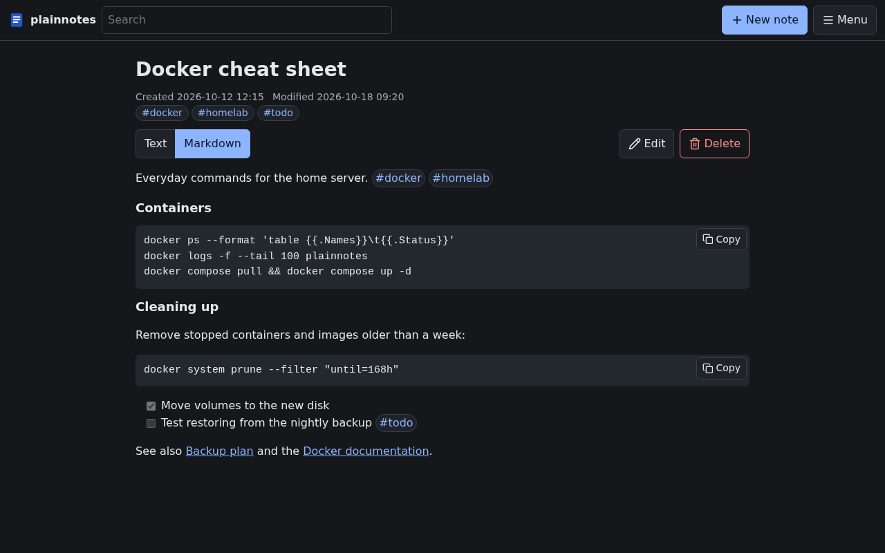

# plainnotes

A self-hosted, single-user web app for writing and finding notes that are stored as plain text files.



## Features

- **Your notes are plain files.** Each note is one UTF-8 `.md` file in its own folder, saved byte for byte. There is no database and no index: edit the files with any editor or sync tool, and the changes show up on the next page load.
- **Write in plain text, read as Markdown.** A plain-text editor, a Text view that shows the file exactly as stored, and a Markdown view with a Copy button on every code block.
- **Find things again.** `#tags` anywhere in the text, `[[wikilinks]]` between notes, pinned notes, and search that ignores case and accents.
- **Attachments of any type and size:** upload them, drag and drop them, or paste a screenshot.
- **Nothing gets lost:** atomic saves, a conflict check when a file changed somewhere else, a trash with undo, and unsaved edits kept in the browser.
- **Small and locked down:** one Docker image that runs as non-root with a read-only filesystem, a strict Content Security Policy, and nothing loaded from the internet.
- Light, dark and auto themes, keyboard shortcuts, printing, a read-only mode and hosting under a sub-path.

```
data/
├── 20261018-143205-k3f9/          one folder per note; the name is the note's ID
│   ├── Docker commands.md         the note; the file name is the title
│   └── attachments/
│       └── compose.yml
└── .trash/                        deleted notes, until you delete them for good
```

## Quick start

Build the image and start it for a local test:

```bash
docker build -t plainnotes .
mkdir -p data   # create it yourself, so it is owned by your user and not by root
docker run -d --name plainnotes \
  -e PLAINNOTES_USERNAME=admin \
  -e PLAINNOTES_PASSWORD='choose-a-long-password' \
  -e PLAINNOTES_SECRET_KEY='paste-64-random-hex-characters-here' \
  -e PLAINNOTES_COOKIE_SECURE=false \
  -v "$(pwd)/data:/data" \
  -p 8080:8080 \
  plainnotes:latest
```

Open <http://localhost:8080/> and log in. Generate the secret key with `openssl rand -hex 32` and keep it the same between restarts: changing it logs out every device. `PLAINNOTES_COOKIE_SECURE=false` lets the browser log in over plain HTTP; use it only for a local test like this one.

The container runs as UID:GID 1000:1000. If your user on the host has a different ID (check with `id -u`), add `--user "$(id -u):$(id -g)"`. If the data folder is not writable, `docker logs plainnotes` shows the `chown` command that fixes it.

## Running behind HTTPS

For use beyond a local test, put plainnotes behind a reverse proxy that provides HTTPS. This example uses Nginx Proxy Manager (NPM), with both containers on Docker's default bridge network:

```bash
mkdir -p data
docker run -d --name plainnotes \
  --restart unless-stopped \
  --read-only --cap-drop ALL --security-opt no-new-privileges \
  -e PLAINNOTES_USERNAME=admin \
  -e PLAINNOTES_PASSWORD='choose-a-long-password' \
  -e PLAINNOTES_SECRET_KEY='paste-64-random-hex-characters-here' \
  -e PLAINNOTES_FORWARDED_ALLOW_IPS='172.17.0.0/16' \
  -v "$(pwd)/data:/data" \
  -p 8080:8080 \
  plainnotes:latest
```

Compared with the quick start, this restarts plainnotes after a reboot, locks the container down and leaves out `PLAINNOTES_COOKIE_SECURE=false`. `PLAINNOTES_FORWARDED_ALLOW_IPS` names the proxy whose `X-Forwarded-For` header is trusted, so the login rate limit sees each visitor's real address instead of the proxy's. `172.17.0.0/16` is Docker's default bridge network: a proxy that runs in Docker on the same server connects from an address in it. If your proxy runs on another machine, use that machine's IP address instead.

Then add a proxy host in NPM:

- **Details:** your domain; scheme `http`; forward hostname/IP: the IP address of the server that runs plainnotes; forward port `8080`. (Containers on the default bridge network cannot reach each other by name.)
- **SSL:** request a certificate and enable **Force SSL** and **HSTS**.
- **Advanced:** paste this, so large uploads are streamed instead of buffered and slow transfers don't time out:

  ```nginx
  client_max_body_size 0;
  proxy_request_buffering off;
  proxy_read_timeout 3600s;
  proxy_send_timeout 3600s;
  ```

Port 8080 on the server also answers over plain HTTP, but browsers cannot log in there: the session cookie is sent only over HTTPS.

To host plainnotes under a sub-path such as `https://example.com/notes/`, set `PLAINNOTES_BASE_PATH=/notes` and add a **Custom location** `/notes` in the NPM proxy host that forwards to the same address and port without stripping the prefix (the same Advanced settings apply).

## Configuration

Everything is configured with environment variables. An invalid value stops the server with a message that names the variable.

| Variable | Default | Meaning |
|---|---|---|
| `PLAINNOTES_USERNAME` | required | Login name (case-sensitive) |
| `PLAINNOTES_PASSWORD` | required | Login password; a warning is logged if it is shorter than 12 characters |
| `PLAINNOTES_SECRET_KEY` | required | At least 32 characters; signs session cookies |
| `PLAINNOTES_DATA_DIR` | `/data` | Folder with the notes; must exist and be writable |
| `PLAINNOTES_HOST` | `0.0.0.0` | Listen address |
| `PLAINNOTES_PORT` | `8080` | Listen port (1–65535) |
| `PLAINNOTES_SESSION_DAYS` | `30` | How long a login lasts (1–365); sessions are renewed while you use them |
| `PLAINNOTES_COOKIE_SECURE` | `true` | Set to `false` only for testing over plain HTTP |
| `PLAINNOTES_FORWARDED_ALLOW_IPS` | `127.0.0.1` | Proxies whose `X-Forwarded-For` header is trusted: comma-separated IP addresses or networks, such as `172.17.0.0/16` for a proxy in Docker on the same server |
| `PLAINNOTES_MAX_UPLOAD_MB` | `0` | Largest upload in MiB; `0` means unlimited |
| `PLAINNOTES_LOG_LEVEL` | `INFO` | `DEBUG`, `INFO`, `WARNING` or `ERROR` |
| `PLAINNOTES_READ_ONLY` | `false` | Serve notes without allowing any change |
| `PLAINNOTES_BASE_PATH` | empty | Serve under a sub-path, e.g. `/notes` (starts with `/`, no trailing `/`) |

Booleans accept `true/false/1/0/yes/no`.

## Security

Everything requires a login, failed logins are rate-limited, and nothing inside a note or an attachment can run code in your browser. [SECURITY.md](SECURITY.md) has the details and explains how to report a vulnerability.

## Documentation

- [User guide](docs/guide.md): your data, writing notes, tags and search, attachments and keyboard shortcuts.
- [Security](SECURITY.md): how to report a vulnerability, the threat model, the controls, the audit and the third-party code.
- [Contributing](CONTRIBUTING.md): running plainnotes from source, the tests and updating dependencies.

## License

MIT, © 2026 Nikolaos Baras; see [LICENSE](LICENSE). If you build on plainnotes, a link back to <https://github.com/nikolaos572/plainnotes> is appreciated.

plainnotes is built with [FastAPI](https://fastapi.tiangolo.com/), [Uvicorn](https://www.uvicorn.org/), [markdown-it](https://github.com/markdown-it/markdown-it), [DOMPurify](https://github.com/cure53/DOMPurify) and [Lucide](https://lucide.dev) icons; see [Third-party code](SECURITY.md#third-party-code) for versions and licences.
